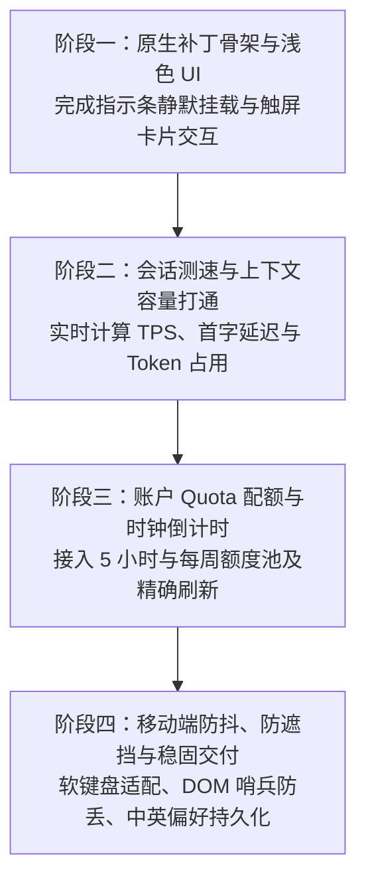

# Antigravity 移动端原生状态仪表盘移植落地规划

> 本文档规范了将 PC 端 Antigrative Dashboard 移植至当前安卓项目（Antigravity for Android）的架构选型、浅色界面视觉规范、四阶段开发路线及移动端避坑准则。
> 全文及未来界面实现均严格遵循无 Emoji 规范，采用纯净轻量矢量图标与专业工程排版。

---

## 一、 架构选型与实现方式确定

### 1. 最终确定的实现方式：移动端原生 Web 补丁（Native Web Patch）
- **核心载体**：在当前项目 `web/src/patches/` 下新建 `dashboard` 模块目录，通过 `src.manifest` 构建流直接编译打包至 `web/generated/`，随应用主 WebView 一体化加载。
- **定位方式**：通过 DOM 巡逻哨兵挂载于聊天输入框底部、模型选择器（Model Picker）右侧，形成与主界面浑然一体的紧凑指示条。
- **数据通道**：直接复用已有 `bridge.core.js` 的 `coreBase()` 与 `x-codeium-csrf-token`，在应用内部直连内核（`LanguageServerService`），无需任何外部网络或中间代理。

### 2. 为什么彻底摒弃电脑端原版的 Node.js 调试注入方案？
- **电脑端妥协方案的痛点**：电脑端由于无法修改官方安装包代码，必须在后台常驻一个 Node.js 进程，通过远程调试端口（CDP）把脚本硬塞进界面。若照搬到手机上，后台进程会被安卓电池优化机制频繁清理，导致仪表盘随时假死或掉线，同时额外增加发热与耗电。
- **安卓端原生方案的优势**：我们拥有完整的 `web/` 前端构建能力，将仪表盘作为原生组件编译进界面，实现**零多余后台进程、零额外电量消耗、随开随显、永久在线**。

---

## 二、 浅色视觉风格设计规范（Light Theme）

为严格契合当前项目 Antigravity 的浅色美学体系，整体设计遵循 Google Material 与现代工程界面的纯净排版，杜绝任何生硬黑边与 Emoji 表情，全要素使用标准单色矢量线框图标。

### 1. 颜色与材质体系
- **主背景基底**：`#ffffff`（纯白底色，与当前应用主工作区一致）
- **卡片与浮层底色**：`rgba(255, 255, 255, 0.92)` 配合 `backdrop-filter: blur(12px)`（细腻半透明微模糊材质）
- **边框与分隔线**：`#e2e8f0`（微浅灰描边，1px 细线）
- **主文本颜色**：`#0f172a`（深石板灰，高可读性）
- **辅助说明文字**：`#64748b`（中灰，用于标签、单位与次要计数）
- **品牌强调主色**：`#0284c7`（Antigravity 经典湖蓝，用于高亮数值与当前选定项）
- **健康状态三色指示**（用于配额与上下文警戒）：
  - 充裕状态（>=70%）：`#16a34a`（柔和青翠绿，非高饱和刺眼绿）
  - 中等状态（30%~70%）：`#d97706`（琥珀暖黄）
  - 紧张状态（<30%）：`#dc2626`（警示正红，附带文字标识）

### 2. 图标规范（严禁使用 Emoji）
所有指示器均采用尺寸为 `14x14px` 或 `16x16px` 的精密 SVG 矢量几何线框：
- **速度指示**：SVG 速度指针刻度盘（Tachometer 线性轮廓）
- **缓存指示**：SVG 芯片存储层（Layers / Chip 线性轮廓）
- **上下文指示**：SVG 环形进度圈（Context Ring 细线条圆环）
- **账户配额**：SVG 计时沙漏（Hourglass 细线几何图形）

---

## 三、 分阶段实施路线图

### 阶段一：原生补丁骨架与浅色 UI 挂载
- **主要目标**：在不破坏当前任何现有功能的前提下，让浅色三合一微指示条稳定显示在输入框旁边。
- **工作内容**：
  1. 在 `web/src/patches/` 下创建 `dashboard` 模块（包含状态管理、视图渲染与 DOM 挂载逻辑）；
  2. 实现微型三图标紧凑布局（宽屏显示数值，极窄屏自适应显示微图标）；
  3. 实现触屏专属展开卡片（点击图标展开，点击卡片外部任意空白遮罩即时收起）；
  4. 配置 `web/src.manifest`，运行 `bash web/build.sh` 打包并测试静态渲染。
- **交付成果**：打开软件即可在模型选择器右侧看到清爽的浅色仪表条，点击可调出结构工整的浅色参数卡片。

### 阶段二：会话测速与上下文容量实时计算
- **主要目标**：接入真实数据流，使速度计与上下文油箱表能够随着 AI 吐字实时跳动。
- **工作内容**：
  1. **首字延迟 (TTFT)**：记录用户点按发送按钮到内核返回第一个流式分块的时间间隔；
  2. **生成速度 (TPS)**：统计流式传输期间实际输出的 Token 数量与流持续时长，计算出精准的字/秒（Tokens/s）；
  3. **上下文占用率**：从内核交互元数据中抓取本次请求的输入 Token 计数与模型最大上下文窗口（如 128,000 / 1,000,000），计算当前占用百分比；
  4. **缓存读取量**：统计提示词缓存（Prompt Cache）命中的 Token 数及缓存复用率。
- **交付成果**：模型回答过程中实时展示速度与延迟，回复完成后沉淀本次交互的准确耗时与上下文容量。

### 阶段三：账户配额 (Quota) 与重置倒计时接入
- **主要目标**：实时呈现 Gemini 与 Claude/GPT 两大模型池的剩余使用额度。
- **工作内容**：
  1. 通过现有 `bridge.core.js` 凭证通道，向本地内核 RPC 接口请求当前认证账户的状态数据；
  2. 解析 5 小时滚动窗口与每周窗口的剩余比例；
  3. 建立前端独立秒级时钟，推算并显示距离下一次额度刷新的剩余时间（如：`02:14:35`）；
  4. 采用浅色进度条，按 70% / 30% 分水岭动态渲染绿、黄、红色彩指示。
- **交付成果**：用户无需盲目猜测额度何时耗尽，随时轻触即可查看当前账户剩余可用百分比与确切恢复时间。

### 阶段四：移动端防抖、软键盘适配与稳固交付
- **主要目标**：全面消除移动端操作特殊性带来的体验瑕疵，确保长期稳定运行。
- **工作内容**：
  1. **软键盘自适应**：监听移动端虚拟键盘弹起事件，弹窗卡片自动调整最大高度（上限为屏幕净高的 45%）并优先向上延展，杜绝被键盘遮挡；
  2. **会话切换清理**：切换至新对话或新建聊天时，即时重置当前会话的流速数据，避免旧会话速度残留干扰；
  3. **双语界面偏好持久化**：支持中文与英文切换，设置结果保存在本地存储中，重启应用自动保留选择；
  4. **全自动编译集成**：将构建步骤固化在 `web/build.sh` 中，后续项目整体更新时可自动化重构。

---

## 四、 关键注意事项与容易踩坑的点（核心防线）

1. **触屏交互假死陷阱（从 Hover 全面转为 Tap）**
   - *问题根源*：PC 端依靠鼠标指针悬停触发卡片，手机没有鼠标，如果直接套用 PC 端的 CSS `:hover`，会导致点击一次后卡片永远粘在屏幕上无法关闭。
   - *防范策略*：采用纯 JavaScript 驱动的状态机机制，点击图标切换打开状态；在全屏幕底层铺设一层透明不可见的遮罩层，手指触摸任意非卡片区域立即平滑收回。

2. **虚拟键盘弹起导致卡片被顶飞或吞噬**
   - *问题根源*：在手机上打字时，系统软键盘弹起会导致 WebView 视口瞬间变矮 50%，PC 端的固定像素定位会把卡片直接挤出屏幕或完全压在键盘下方。
   - *防范策略*：卡片挂载在输入框容器内部上方，采用相对于当前视口的动态最大高度约束（`max-height: calc(100vh - 360px)`），配合内部平滑滚动条，确保在任何输入法弹起状态下都能看全数据。

3. **React 虚拟 DOM 重绘把挂载节点“冲走”**
   - *问题根源*：用户切换模型、点击换行或发送指令时，宿主 React 界面会重新渲染整个底栏，如果仅在页面加载时注入一次 DOM，会被 React 的重绘流程直接彻底抹除。
   - *防范策略*：采用轻量高效的 `MutationObserver`（DOM 变动监听器），一旦检测到底部工具栏被重构，系统将在毫秒级别内将仪表盘重新精准嵌入，确保常驻不闪烁。

4. **手机网络抖动导致的瞬时 TPS 假峰值**
   - *问题根源*：移动蜂窝网络下数据包偶尔会积压在传输队列中，瞬间一口气吐出数十个 Token，如果单纯用瞬时微秒差计算，会算出 3000+ TPS 的虚假飙车数据。
   - *防范策略*：严格继承原项目的有效样本过滤逻辑，剔除时长不足 1 秒或极短的网络缓冲抖动，采用加权滑动平均算法，呈现真实可信的生成速度。

5. **端口安全与同源策略约束**
   - *问题根源*：安卓运行环境中，45157 与 45158 为核心预留通信端口，严禁私自占用；在 WebView 中发起任何跨域请求都会触发跨域错误。
   - *防范策略*：绝对不另起任何本地监听端口，所有数据全部通过当前应用原本的 `window.__AG_ENDPOINTS__` 以及 `x-codeium-csrf-token` 通道进行内部调用，百分之百规避跨域拦截。

---

## 五、 实施就绪核对清单

- [x] 明确技术实现路径为移动端原生 Web 补丁模式；
- [x] 确立纯白底色、微浅灰边框与湖蓝强调的 Antigravity 浅色视觉标准；
- [x] 明确界面与文档全面剔除 Emoji，改用精密单色 SVG 矢量线框图标；
- [x] 制定四阶段递进式开发节点与严格的移动端避坑准则。
